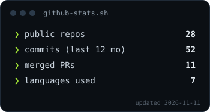
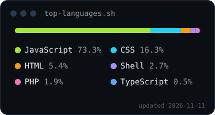

<h1>Hi  I'm Anand K Anil</h1>

**Full-stack developer** building real-time, voice and AI-powered web apps — from React front ends to the Node APIs and cloud functions behind them. Previously an SAP CAR consultant at **TCS**. Based in **Kochi, Kerala**.

- 🔭 Building **[Aura](https://github.com/Anandkanil/aura)**, a voice assistant that answers in the language you speak
- 🌱 Learning system design and scaling real-time apps
- 💼 Open to software engineering roles
- ⚡ Fun fact: I'm secretly Spider-Man… but don't tell anyone

---

### 🚀 Featured projects

<table>
  <tr>
    <td width="50%" valign="top">
      
      <h4><a href="https://github.com/Anandkanil/aura">Aura</a> — voice AI assistant</h4>
      Talk or type in English, Malayalam, Hindi and more. Aura detects your language, streams a reply and reads it aloud. 
      React · Netlify Functions · Gemini · Web Speech API 
      <a href="https://auraa-voice.netlify.app/">Live demo</a> · <a href="https://github.com/Anandkanil/aura">Code</a>
    </td>
    <td width="50%" valign="top">
      
      <h4><a href="https://github.com/Anandkanil/collab-whiteboard">CollabBoard</a> — real-time whiteboard</h4>
      Draw together with live cursors, chat, version history, a host lock and AI board summaries. 
      React · Firebase · Fabric.js · Gemini 
      <a href="https://anand-whiteboard.netlify.app/">Live demo</a> · <a href="https://github.com/Anandkanil/collab-whiteboard">Code</a>
    </td>
  </tr>
</table>

- **[StudyNotion](https://github.com/Anandkanil/Study-Notion-Project)** — MERN EdTech platform with auth, course management and password recovery · [live](https://studynotion-project-1.netlify.app/)
- **[Portfolio](https://github.com/Anandkanil/portfolio)** — terminal-style developer portfolio with light/dark themes · [live](https://anandkanil-portfolio.netlify.app/)
- **[ReachYourTherapist](https://github.com/Anandkanil/reachyourtherapist)** — platform for finding and consulting therapists online

### 🛠 Tech I work with

  
  
  
  
  
  
  
  
  
  
  
  
  
  
  
  
  
  

### 📊 GitHub stats

  
  

Generated daily by a GitHub Action in this repo, so the cards never break.
